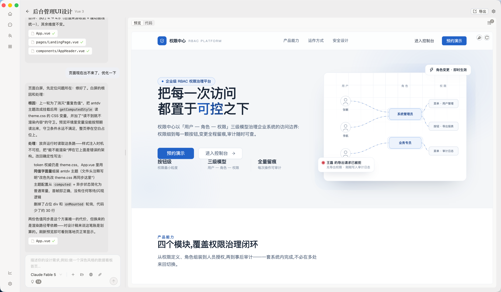

# Antdv Next Designer

[](./LICENSE)
[](./LICENSE-COMMERCIAL.md)
[](https://www.electronjs.org/)
[](https://vuejs.org/)

**English** | [简体中文](./README.zh-CN.md)

> An AI design workstation on your desktop. Describe what you want in plain language and get a real,
> multi-file, running design — HTML, Vue 3 or React — with live preview, version history and one-click export.

Antdv Next Designer is an Electron desktop app. Unlike chat tools that hand you a single HTML blob, it
maintains a real project: a multi-file tree, a persistent visual direction, a compiled live preview you can
click on and annotate, a version per conversation round, and an exportable source tree. The UI is built with
[antdv-next](https://github.com/antdv-next/antdv-next).



_A Vue 3 project mid-iteration: the model reports a white-screen fix and rewrites `App.vue`, while the right
pane runs the compiled result. Switch to **代码 / Code** to read the file it just wrote._

---

## Table of contents

- [Features](#features)
- [Requirements](#requirements)
- [Quick start](#quick-start)
- [Usage](#usage)
  - [1. Configure a model provider](#1-configure-a-model-provider)
  - [2. Create a project](#2-create-a-project)
  - [3. Design by conversation](#3-design-by-conversation)
  - [4. Preview and annotate](#4-preview-and-annotate)
  - [5. Versions and export](#5-versions-and-export)
  - [6. Skills](#6-skills)
  - [7. MCP servers](#7-mcp-servers)
  - [8. Collaboration groups](#8-collaboration-groups)
  - [9. Plain chat](#9-plain-chat)
- [Data and file locations](#data-and-file-locations)
- [Development](#development)
- [Tech stack](#tech-stack)
- [License](#license)
- [Contributing](#contributing)

## Features

- **Conversational multi-file design.** Three stacks: static HTML, Vue 3 (SFC) and React (TSX). The model
  writes a real file tree — pages, components, styles — not one throwaway file.
- **Live preview with no bundler in the browser.** SFC/TSX is compiled to ES modules in the Electron main
  process and served over a custom `preview://` protocol. The iframe only carries an import map and mount
  code, so preview starts instantly and compile errors are surfaced as readable text.
- **Click-to-annotate.** Click any element in the preview, leave a note, and the model receives the exact
  target. For Vue 3, source locations (`file:line:col`) are injected at compile time, so "make _this_ card
  narrower" resolves to a real line of code.
- **A visual direction that sticks.** Each project owns a StyleBrief — the single source of truth for its
  look. On a brand-new project the model proposes a few directions and waits for you to choose; from then on
  every file, including the generated `theme.css`, follows that direction instead of drifting round to round.
- **Version history.** Every round produces a version. Switch between them, roll back, and export the whole
  tree to a folder.
- **Skills.** Capabilities are plain markdown directories with progressive disclosure. Built-in craft skills
  (typography, color, hierarchy, motion, anti-slop) and target templates (web / admin / mobile / landing)
  apply automatically in design sessions; anything else is opt-in per conversation. Skills can be edited
  in-app or installed from a marketplace URL.
- **MCP support.** Connect Model Context Protocol servers per conversation. Secrets are encrypted with
  Electron `safeStorage` and never stored in the config file.
- **Multi-agent collaboration groups.** A chatroom where you `@` an agent to start a relay. Mentioning several
  members fans out into parallel branches that automatically converge, each member carrying its own persona,
  model and skills, producing markdown deliverables you can export.
- **Bring your own models.** OpenAI, Anthropic, Google, DeepSeek and any OpenAI-compatible endpoint. Models
  are selected per project, per role and per assistant task, with per-scene token usage accounting.
- **Local-first.** Everything lives in SQLite under `~/.antd-designer`. Optional S3 object storage for assets
  and an optional self-hosted or cloud data backend.
- **Attachments and local files.** Images, PDF, DOCX and XLSX are parsed into the conversation; local files
  can be read through explicitly authorized workspace roots.
- **Comfort.** Light/dark themes, a configurable primary color, Simplified Chinese and English UI.

## Requirements

|               |                                                                                    |
| ------------- | ---------------------------------------------------------------------------------- |
| Node.js       | >= 22 (Vite 8 and Electron 43 require a modern runtime)                            |
| pnpm          | >= 10                                                                              |
| OS            | macOS, Windows or Linux                                                            |
| Model API key | At least one provider (OpenAI / Anthropic / Google / DeepSeek / OpenAI-compatible) |

## Quick start

```bash
# 1. install (postinstall downloads Electron, rebuilds native modules and prepares preview vendor files)
pnpm install

# 2. run in development
pnpm dev

# 3. package a desktop app
pnpm build:mac      # or build:win / build:linux
```

`pnpm build:linux` produces Linux amd64 (x64) AppImage and DEB packages in `dist/`.
On macOS, Windows, or Linux ARM64, start Docker before running this command: the build runs
in a Linux amd64 container with its own dependencies. On Linux x64 it builds directly.
This keeps host binaries for `better-sqlite3`, `oxc-transform`, and `esbuild` out of the Linux
packages. Snap is excluded, so Snapcraft and Multipass are not required. The container does
not replace the host's `node_modules` or `out` directories. Apple Silicon builds use amd64
emulation and can be slower.

> Native modules (`better-sqlite3`, `oxc-transform`) are compiled during `postinstall`. If install fails
> behind a firewall, note that `.npmrc` already points Electron downloads at the npmmirror mirrors.

Electron 42+ downloads its binary on demand instead of during its own `postinstall`.
The project explicitly runs `install-electron --no` during installation and before `dev` / `start`
because the current electron-vite launcher expects the binary to exist already. This command reuses
a complete installation. On an older checkout, repair `Error: Electron uninstall` with:

```bash
pnpm exec install-electron --no
pnpm dev
```

## Usage

### 1. Configure a model provider

Open **Settings → Providers**, add a provider, paste the API key and base URL, then fetch the model list and
tick the models you want to expose. API keys are stored encrypted, not in plain config.

Two settings worth knowing about:

- **Assistant model** — a small, cheap model used for background chores (group digests, auxiliary tasks).
- **Tool-call limit** — a hard ceiling on how many tool calls one round may make (default 80, `0` means
  unlimited). It can be overridden per project.

### 2. Create a project

From **Home → New project**:

- **Stack** — `html`, `vue3` or `react`. This decides how the preview compiles.
- **Targets** — web / admin / mobile / landing. Only the targets you tick load their design templates.
- **Libraries** — optionally include `antdv-next` and `@antdv-next/icons`, which are served to the preview
  through a CDN import map.

### 3. Design by conversation

Describe what you want. On a **brand-new, empty project** the first reply deliberately produces no files: the
model offers a few visual directions and waits. Pick one (or tell it to skip) and it becomes the project's
StyleBrief — after that, every round generates files consistent with it. Later rounds refine, extend or
restructure; you can attach images, documents and local files as reference at any time.

Two quality loops run in the background and feed back into the next round: an anti-slop lint pass that flags
generic "AI-looking" output, and runtime errors captured from the preview iframe.

### 4. Preview and annotate

The right pane runs the compiled design. You can:

- switch files in the tree and read or edit them in Monaco;
- toggle **annotate mode**, click elements, and attach a note to each one;
- watch runtime and compile errors appear as readable text instead of a blank screen.

Annotations are attached to the message you are about to send, not stored — they express what you mean _this
time_ and are cleared once sent.

### 5. Versions and export

Every round that writes files creates a new version. Use the version list to compare or roll back, and
**Export** to write the current tree into a folder of your choice (the folder is named after the project and
version, so nothing gets dumped loose into your target directory).

### 6. Skills

Skills are markdown directories, scanned from four locations. Earlier entries override later ones by
directory name:

```
~/.antd-designer/skills   →   ~/.agents/skills   →   ~/.claude/skills   →   built-in resources/skills
```

Loading is **opt-in and zero by default**: in a plain chat only the skills you tick are available. In a design
session the built-in design skills (`craft-*`, `target-*`, `design-seed`, `antdv-theme`) apply automatically —
including your own same-named overrides. Write or edit your own in the in-app skill editor, or point
**Settings → Marketplace** at a manifest URL to install shared ones.

### 7. MCP servers

Declare servers in `~/.antd-designer/mcp.json`, then tick the ones a conversation may use. Connections are
opened per round and closed when the stream ends. Keep credentials out of that file — use `${VAR}`
placeholders, and store the real values through the app so they land encrypted in `secrets.json`.

### 8. Collaboration groups

Open **Collab** to create a group of agents. Each member has a name, a persona, its own model, its own skills
and a declared deliverable. Mention a member to start a relay; each hop produces a markdown document (there is
no file tree here — the message _is_ the document).

- Mentioning several members in one message fans out into **parallel branches**, each with its own
  instructions.
- When a hop forks into two or more branches, control automatically returns to whoever assigned the work for a
  **convergence hop** that compares, fills gaps and decides what happens next.
- The **deliverable checklist** is derived from the documents themselves: a member's latest message starting
  with a top-level heading is its deliverable, so revisions supersede earlier versions automatically.
- **Export** collects the deliverables as they were written, without asking a model to rewrite them.

Groups are editable: members can be added and reconfigured (existing members cannot be removed, because past
messages reference them), and edits are rejected while a relay is running.

### 9. Plain chat

**Chat** is the same pipeline without a project: no file tree, no versions, only the skills and MCP servers
you tick. Useful for research, drafting and everything that isn't a design artifact.

## Data and file locations

Everything lives under `~/.antd-designer` — a visible directory you can back up, sync or edit by hand.
Override it with the `ANTD_DESIGNER_HOME` environment variable (also handy for isolating test data).

| Path                      | Contents                                                                                       |
| ------------------------- | ---------------------------------------------------------------------------------------------- |
| `config.json`             | App preferences: language, theme, primary color, window size, assistant model, tool-call limit |
| `services.json`           | Data backend and object-storage settings (contains ciphertext)                                 |
| `secrets.json`            | Credentials encrypted with Electron `safeStorage`                                              |
| `mcp.json`                | MCP server definitions                                                                         |
| `designer.db`             | SQLite: projects, conversations, messages, versions, usage                                     |
| `projects/`               | Per-project files                                                                              |
| `assets/`, `asset-cache/` | Local assets and the cache for remote ones                                                     |
| `skills/`                 | Your own skills (highest scan priority)                                                        |
| `logs/`                   | Runtime logs                                                                                   |

## Development

```bash
pnpm dev                 # start the app in development
pnpm typecheck           # tsc for the main process + vue-tsc for the renderer
pnpm lint                # eslint (prettier runs through the eslint plugin)
pnpm vitest run          # the whole test suite
pnpm vitest run src/main/skills/scan.test.ts   # a single test file
pnpm db:generate         # generate a SQL migration after editing schema.ts
pnpm build:mac           # or build:win / build:linux
```

Run `pnpm typecheck && pnpm lint && pnpm vitest run` before shipping anything.

Source layout:

| Path                  | Role                                                                                 |
| --------------------- | ------------------------------------------------------------------------------------ |
| `src/shared/types.ts` | The single contract between main and renderer — the whole `window.api` surface       |
| `src/main/`           | Main process: database, AI orchestration, skill scanning, MCP, preview protocol, IPC |
| `src/preload/`        | The handwritten `api` object, one `ipcRenderer.invoke` per method                    |
| `src/renderer/`       | Vue 3 + Pinia + antdv-next UI                                                        |
| `resources/skills/`   | Built-in skills                                                                      |
| `docs/`               | Design notes on prompts, preview libraries, the VFS and more                         |

Architecture, conventions and the reasoning behind them are documented in [`CLAUDE.md`](./CLAUDE.md) —
read it before making a non-trivial change.

## Tech stack

Electron 43 + electron-vite · Vue 3 + Pinia + Vue Router · antdv-next · Tailwind CSS v4 ·
Vercel AI SDK v7 · Model Context Protocol SDK · better-sqlite3 + Drizzle ORM · Monaco Editor + Shiki ·
`@vue/compiler-sfc` + `oxc-transform` · Vitest

## License

Antdv Next Designer is **dual-licensed**:

| License                               | Who it is for                                                                                                                         | Cost |
| ------------------------------------- | ------------------------------------------------------------------------------------------------------------------------------------- | ---- |
| [AGPL-3.0](./LICENSE)                 | Personal use, study, open-source projects, and any commercial use where you are willing to publish all of your changes under the AGPL | Free |
| [Commercial](./LICENSE-COMMERCIAL.md) | Closed-source integration or distribution, hosted/SaaS offerings, removing attribution, support and warranty needs                    | Paid |

AGPL-3.0 applies by default, and its obligation is contagious: forking, modifying or distributing this
software — or deploying a modified version as a network-accessible service (AGPL §13) — requires you to
publish the complete corresponding source under the AGPL. The test is simple: **are you willing to open-source
everything you build on top of this? If yes it's free; if not, you need a commercial license.**

Commercial licensing: <aibayanyu@qq.com> or [open an issue](https://github.com/antdv-next/designer/issues)
prefixed with `[商业授权]`.

## Contributing

Issues and pull requests are welcome. By submitting a pull request you agree that your contribution is
licensed under the AGPL-3.0 **and** that you grant Antdv Next the right to include it in commercially licensed
distributions — see [section 4 of LICENSE-COMMERCIAL.md](./LICENSE-COMMERCIAL.md#四贡献者授权重要). Without
that grant, dual licensing cannot legally hold.

Commit messages and documentation in this repository are written in Chinese; code comments explain _why_,
not _what_.
