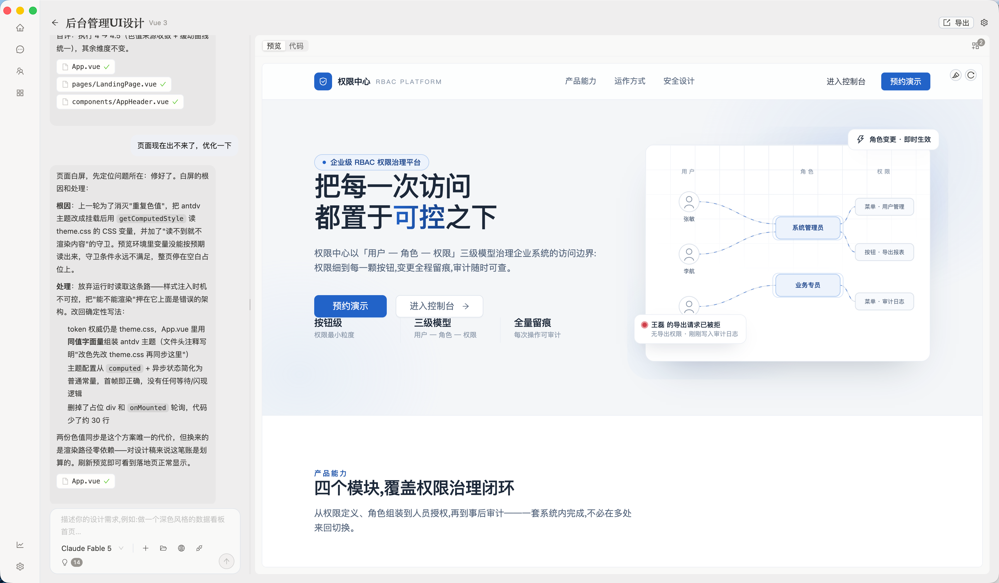

# Antdv Next Designer

[](./LICENSE)
[](./LICENSE-COMMERCIAL.md)
[](https://www.electronjs.org/)
[](https://vuejs.org/)

[English](./README.md) | **简体中文**

> 桌面端的 AI 设计工作台。用一句话描述你要什么，拿到的是**能跑起来的多文件设计稿**——
> HTML、Vue 3 或 React——带实时预览、版本历史和一键导出。

Antdv Next Designer 是一个 Electron 桌面应用。和"丢给你一坨 HTML"的聊天工具不同，它维护的是一个真实项目：
多文件目录树、贯穿全项目的视觉方向、可点击标注的编译级预览、每一轮对话一个版本、可导出的源码树。
界面基于 [antdv-next](https://github.com/antdv-next/antdv-next) 构建。



_一个 Vue 3 项目迭代中的样子：模型说明白屏的根因并重写 `App.vue`，右侧面板跑的就是编译后的结果。
切到**代码**页签即可读它刚写的文件。_

---

## 目录

- [功能](#功能)
- [环境要求](#环境要求)
- [快速开始](#快速开始)
- [使用说明](#使用说明)
  - [1. 配置模型供应商](#1-配置模型供应商)
  - [2. 创建项目](#2-创建项目)
  - [3. 对话生成设计稿](#3-对话生成设计稿)
  - [4. 预览与标注](#4-预览与标注)
  - [5. 版本与导出](#5-版本与导出)
  - [6. 技能](#6-技能)
  - [7. MCP 服务](#7-mcp-服务)
  - [8. 多 agent 协作群组](#8-多-agent-协作群组)
  - [9. 纯聊天](#9-纯聊天)
- [数据与文件位置](#数据与文件位置)
- [开发](#开发)
- [技术栈](#技术栈)
- [许可](#许可)
- [贡献](#贡献)

## 功能

- **对话生成多文件设计稿。** 支持三种技术栈：静态 HTML、Vue 3（SFC）、React（TSX）。模型写出的是真实的
  文件树——页面、组件、样式，而不是一个用完就丢的单文件。
- **浏览器里没有打包器的实时预览。** SFC / TSX 在 Electron **主进程**编译成 ES 模块，通过自定义
  `preview://` 协议直出；iframe 里只有 import map 和挂载代码。预览秒开，编译失败也会以可读文本呈现，
  而不是白屏。
- **点击即标注。** 在预览里点任意元素、写一句备注，模型收到的是精确目标。Vue 3 会在编译期注入源码位置
  （`file:行:列`），所以"把**这张**卡片收窄一点"能落到具体那一行代码上。
- **视觉方向不会跑偏。** 每个项目有一份 StyleBrief，是整体视觉的唯一事实来源。全新空项目的第一轮**故意
  不产出文件**：模型先给几个视觉方向等你选，选定后它就成为项目的 StyleBrief——此后每一轮生成的文件
  （包括自动生成的 `theme.css`）都遵循同一个方向，不再一轮一个样。
- **版本管理。** 每一轮写文件都产生一个版本，可切换、可对比、可回滚，也可以把整棵树导出到磁盘。
- **技能系统。** 技能就是 markdown 目录，按需渐进披露。内置的手艺技能（排版、色彩、层级、动效、反 AI 味）
  与端模板（web / admin / mobile / landing）在设计会话里自动生效，其余一律按会话手动勾选。技能可以在
  应用内直接编辑，也可以从市场地址安装。
- **MCP 支持。** 按会话勾选 Model Context Protocol 服务，按轮连接、流结束即关闭。密钥用 Electron
  `safeStorage` 加密保存，不落进配置文件。
- **多 agent 协作群组。** 一个聊天室：`@` 某位成员发起接力。一条消息 `@` 多位就分叉成**并行分支**，
  跑完自动汇合；每位成员携带自己的人设、模型和技能，产出 markdown 文档，可整体导出。
- **模型自带。** OpenAI、Anthropic、Google、DeepSeek 以及任意 OpenAI 兼容端点。模型按项目、按角色、
  按辅助任务分别选择，并按场景统计 token 用量。
- **本地优先。** 数据全在 `~/.antd-designer` 下的 SQLite 里。资源可选接入 S3 对象存储，数据后端可选
  自托管或云端。
- **附件与本地文件。** 图片、PDF、DOCX、XLSX 会被解析进对话；本地文件通过显式授权的工作区根目录读取。
- **顺手的细节。** 亮/暗主题、可配置主色、中英文界面。

## 环境要求

|              |                                                                        |
| ------------ | ---------------------------------------------------------------------- |
| Node.js      | >= 22（Vite 8 与 Electron 43 需要较新的运行时）                        |
| pnpm         | >= 10                                                                  |
| 操作系统     | macOS、Windows 或 Linux                                                |
| 模型 API Key | 至少一家供应商（OpenAI / Anthropic / Google / DeepSeek / OpenAI 兼容） |

## 快速开始

```bash
# 1. 安装依赖（postinstall 会重建原生模块并准备预览用的 vendor 文件）
pnpm install

# 2. 开发模式运行
pnpm dev

# 3. 打包桌面应用
pnpm build:mac      # 或 build:win / build:linux
```

> 原生模块（`better-sqlite3`、`oxc-transform`）在 `postinstall` 阶段编译。网络受限时注意 `.npmrc`
> 已经把 Electron 相关下载指向了 npmmirror 镜像。

## 使用说明

### 1. 配置模型供应商

打开**设置 → 供应商**，添加供应商、填入 API Key 与 Base URL，拉取模型列表并勾选要用的模型。
API Key 加密保存，不会明文进配置文件。

两个值得留意的设置：

- **辅助模型**——用于后台杂活（群聊前情纪要等）的小而便宜的模型。
- **工具调用上限**——单轮工具调用次数的硬上限（默认 80，`0` 表示不限），可以按项目单独覆盖。

### 2. 创建项目

在**首页 → 新建项目**里：

- **技术栈**——`html`、`vue3` 或 `react`，决定预览如何编译；
- **端类型**——web / admin / mobile / landing，勾了哪些端就只加载哪些端的设计模板；
- **组件库**——可选带上 `antdv-next` 与 `@antdv-next/icons`，通过 CDN import map 供预览使用。

### 3. 对话生成设计稿

直接描述你要什么。**全新空项目**的第一轮回复刻意不产出文件：模型会给出几个视觉方向并等你确认。选定
（或明确跳过）之后，它成为项目的 StyleBrief，此后每一轮都按它生成一致的文件。后续轮次做细化、扩展或
重构；任何时候都可以附上图片、文档和本地文件作为参考。

后台还跑着两个质量闭环，结果会回流到下一轮：反 AI 味 lint（挑出千篇一律的"AI 感"产出），以及从预览
iframe 捕获的运行时报错。

### 4. 预览与标注

右侧面板运行的就是编译后的设计稿。你可以：

- 在文件树里切换文件，用 Monaco 阅读或编辑；
- 打开**标注模式**，点选元素并逐个写备注；
- 直接看到编译与运行时报错的可读文本，而不是一片空白。

标注**附着在你即将发出的那条消息上**，不落库——它表达的是你这一次的意图，发完即清空。

### 5. 版本与导出

每一轮写文件都会创建新版本。用版本列表对比或回滚，用**导出**把当前文件树写到你选的目录下（导出目录
按项目名与版本号命名，不会把一堆文件直接倒进你选的目录）。

### 6. 技能

技能是 markdown 目录，从四个位置扫描，**靠前的按目录名覆盖靠后的**：

```
~/.antd-designer/skills   →   ~/.agents/skills   →   ~/.claude/skills   →   内置 resources/skills
```

加载是**手动勾选制、默认零加载**：纯聊天里只有勾选的技能可用。设计会话里内置设计技能
（`craft-*`、`target-*`、`design-seed`、`antdv-theme`）自动生效——包含你用同名目录覆盖的版本。
可以在应用内的技能编辑器里写自己的技能，也可以在**设置 → 市场**里配置清单地址来安装共享技能。

### 7. MCP 服务

在 `~/.antd-designer/mcp.json` 里声明服务，然后按会话勾选。连接按轮建立，流结束即关闭，不留孤儿子进程。
**不要把密钥写进这个文件**——配置里只写 `${VAR}` 占位，真实值通过应用录入，加密存进 `secrets.json`。

### 8. 多 agent 协作群组

打开**协作**创建群组。每位成员有名字、人设、自己的模型、自己的技能和明确的交付物。`@` 某位成员即发起
接力；每一棒产出一篇 markdown 文档（这里没有文件树——**消息本身就是文档**）。

- 一条消息 `@` 多位成员会**分叉成并行分支**，每人只拿到交代给自己的那段；
- 一棒分叉出两条以上时，控制权会自动交回**派活的那位**跑一棒**汇合**：对照、补缺、定去向；
- **交付清单是从文档本身派生的**：某成员最新一条以一级标题开头的消息就是它的交付物，返工版本自动
  覆盖旧版；
- **导出**只收交付物原文，绝不让模型再写一份"汇总文档"。

群组可编辑：可以新增成员、修改成员配置（已有成员不能删除，因为历史消息引用着它们），接力进行中拒绝保存。

### 9. 纯聊天

**聊天**页是同一条链路去掉项目：没有文件树、没有版本，只有你勾选的技能与 MCP 服务。适合调研、起草，
以及一切不产出设计稿的事。

## 数据与文件位置

所有数据都在 `~/.antd-designer` 下——一个你能直接翻看、备份、同步、手改的可见目录。
可以用环境变量 `ANTD_DESIGNER_HOME` 覆盖位置（跑测试时隔离数据也方便）。

| 路径                      | 内容                                                         |
| ------------------------- | ------------------------------------------------------------ |
| `config.json`             | 应用配置：语言、主题、主色、窗口尺寸、辅助模型、工具调用上限 |
| `services.json`           | 数据后端与对象存储配置（含密文）                             |
| `secrets.json`            | 用 Electron `safeStorage` 加密的凭据                         |
| `mcp.json`                | MCP 服务定义                                                 |
| `designer.db`             | SQLite：项目、会话、消息、版本、用量                         |
| `projects/`               | 各项目的文件                                                 |
| `assets/`、`asset-cache/` | 本地资源与远程资源缓存                                       |
| `skills/`                 | 你自己的技能（扫描优先级最高）                               |
| `logs/`                   | 运行日志                                                     |

## 开发

```bash
pnpm dev                 # 启动开发
pnpm typecheck           # 主进程 tsc + 渲染进程 vue-tsc
pnpm lint                # eslint（prettier 走 eslint 插件）
pnpm vitest run          # 全部测试
pnpm vitest run src/main/skills/scan.test.ts   # 单个测试文件
pnpm db:generate         # 改完 schema.ts 生成 SQL 迁移
pnpm build:mac           # 或 build:win / build:linux
```

交付前三件套都要过：`pnpm typecheck && pnpm lint && pnpm vitest run`。

目录结构：

| 路径                  | 职责                                                  |
| --------------------- | ----------------------------------------------------- |
| `src/shared/types.ts` | 主/渲染进程的唯一契约，定义了整个 `window.api` 面     |
| `src/main/`           | 主进程：数据库、AI 编排、技能扫描、MCP、预览协议、IPC |
| `src/preload/`        | 手写的 `api` 对象，每个方法一行 `ipcRenderer.invoke`  |
| `src/renderer/`       | Vue 3 + Pinia + antdv-next 界面                       |
| `resources/skills/`   | 内置技能                                              |
| `docs/`               | prompt、预览组件库、VFS 等设计说明                    |

架构、约定以及它们背后的取舍都写在 [`CLAUDE.md`](./CLAUDE.md) 里——动非平凡改动之前先读它。

## 技术栈

Electron 43 + electron-vite · Vue 3 + Pinia + Vue Router · antdv-next · Tailwind CSS v4 ·
Vercel AI SDK v7 · Model Context Protocol SDK · better-sqlite3 + Drizzle ORM · Monaco Editor + Shiki ·
`@vue/compiler-sfc` + `oxc-transform` · Vitest

## 许可

Antdv Next Designer 采用**双重授权**：

| 授权方式                            | 适用场景                                                         | 费用 |
| ----------------------------------- | ---------------------------------------------------------------- | ---- |
| [AGPL-3.0](./LICENSE)               | 个人学习、研究、开源项目；以及愿意按 AGPL 开源全部改动的商业使用 | 免费 |
| [商业授权](./LICENSE-COMMERCIAL.md) | 闭源集成 / 分发、对外提供 SaaS、去除署名、需要支持与担保         | 付费 |

默认适用 AGPL-3.0，其核心义务是**传染性**：fork、修改、分发本软件，或把修改版部署成任何人可通过网络
访问的服务（AGPL 第 13 条），都必须以 AGPL-3.0 公开完整对应源码。判断标准就一句话——**你愿不愿意把
基于本项目做的改动全部开源？愿意就免费，不愿意就需要商业授权。**

商业授权咨询：<aibayanyu@qq.com>，或[提交 Issue](https://github.com/antdv-next/designer/issues) 并注明
`[商业授权]`。

## 贡献

欢迎提 Issue 和 Pull Request。提交 Pull Request 即表示你同意：贡献以 AGPL-3.0 授权，**并且**授予
Antdv Next 将其纳入商业许可版本对外授权的权利——详见
[LICENSE-COMMERCIAL.md 第四节](./LICENSE-COMMERCIAL.md#四贡献者授权重要)。没有这项授权，双重授权在
法律上无法成立。

本仓库的提交信息与文档使用中文；代码注释写"为什么"而不是"做了什么"。
